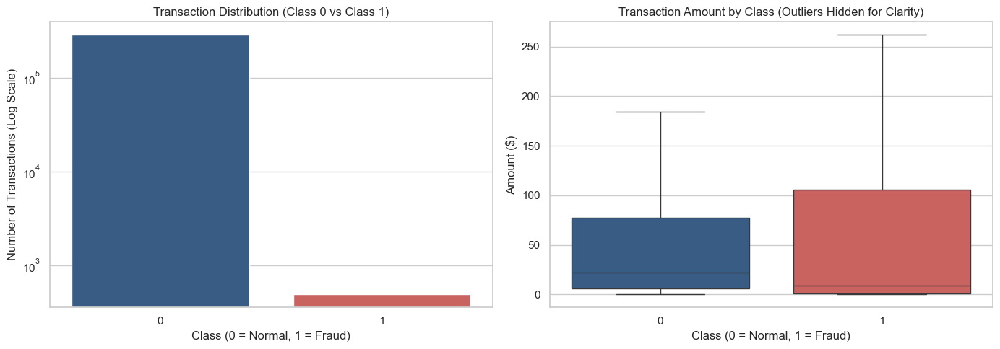
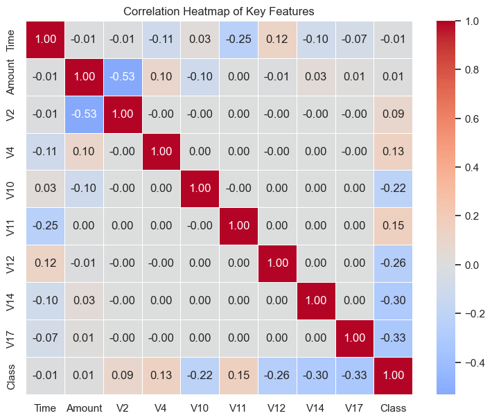
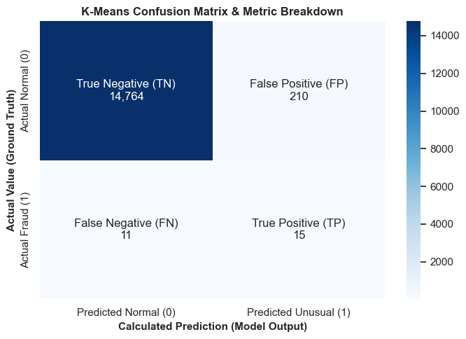
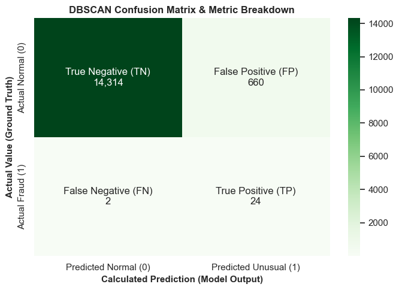
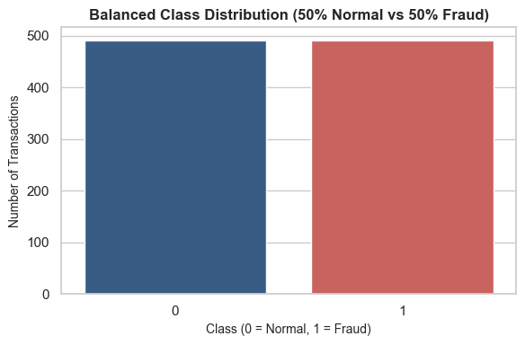
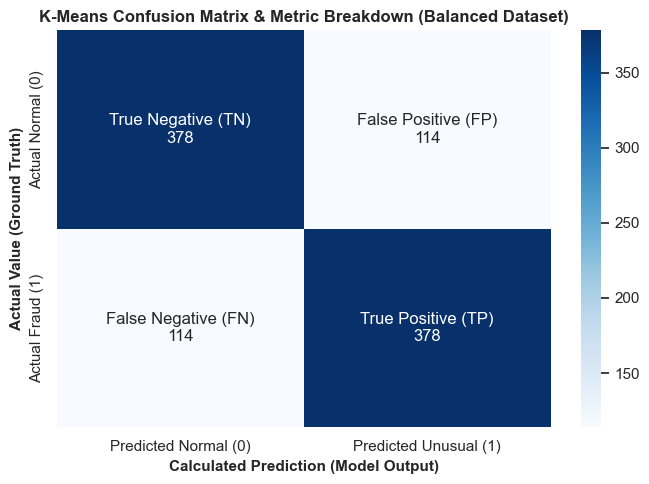
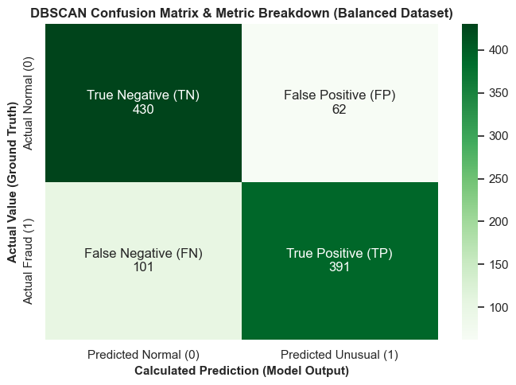
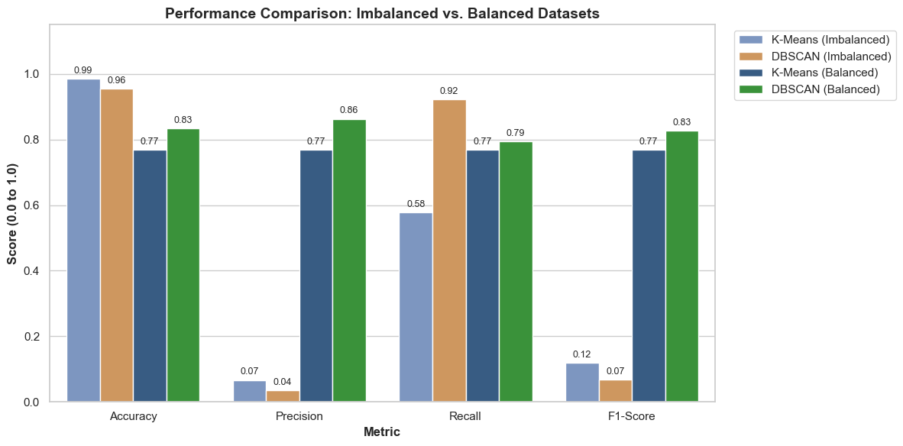

# TransactionPatterns: Unsupervised Anomaly Detection for Credit Card Fraud

[](https://www.python.org/)
[](https://jupyter.org/)
[](https://scikit-learn.org/)
[](LICENSE)
[](https://github.com/Rukaiya-afk/TransactionPatterns)

An end-to-end machine learning study investigating **unsupervised anomaly detection algorithms** for identifying fraudulent transactions in financial systems. This repository analyzes the performance of **K-Means Clustering** (distance-based) and **DBSCAN** (density-based) across both **extreme class imbalance** (~0.17% fraud) and **strictly balanced distributions** (1:1 under-sampling), providing empirical solutions to the **Precision Paradox**.

---

## Table of Contents
- [Project Overview](#project-overview)
- [The Challenge: Extreme Class Imbalance & Precision Paradox](#the-challenge-extreme-class-imbalance--precision-paradox)
- [Dataset Architecture & Preprocessing](#dataset-architecture--preprocessing)
- [Unsupervised Anomaly Detection Models](#unsupervised-anomaly-detection-models)
  - [1. Distance-Based Anomaly Detection (K-Means)](#1-distance-based-anomaly-detection-k-means)
  - [2. Density-Based Anomaly Detection (DBSCAN)](#2-density-based-anomaly-detection-dbscan)
- [Experimental Results & Comparison](#experimental-results--comparison)
  - [Experiment 1: Heavily Imbalanced Dataset](#experiment-1-heavily-imbalanced-dataset)
  - [Experiment 2: Balanced Dataset (1:1 Under-Sampling)](#experiment-2-balanced-dataset-11-under-sampling)
  - [Master Benchmark Comparison](#master-benchmark-comparison)
- [Visual Insights & Diagnostics](#visual-insights--diagnostics)
- [Key Conclusions & Takeaways](#key-conclusions--takeaways)
- [Project Structure](#project-structure)
- [Installation & Setup](#installation--setup)
- [How to Run](#how-to-run)
- [Data Source & References](#data-source--references)

---

## Project Overview

In enterprise banking and payment processing, fraudulent activities represent a minute fraction of total transaction volume. Supervised learning often suffers from severe overfitting to known fraud signatures and fails to flag novel attack vectors.

This study implements and compares **unsupervised clustering techniques** to uncover hidden patterns and isolate fraud transactions as anomalies without relying on target labels during training:
1. **K-Means Clustering Anomaly Detection**: Assigns transactions into multiple clusters in high-dimensional feature space and flags points that lie unusually far from their respective cluster centroids.
2. **DBSCAN Density-Based Spatial Clustering**: Evaluates neighborhood density (`eps=4.5`, `min_samples=10`) and designates isolated noise points (`-1`) as fraudulent anomalies.

---

## The Challenge: Extreme Class Imbalance & Precision Paradox

In the raw credit card dataset:
- Total Transactions: **284,807**
- Normal Transactions (`Class = 0`): **284,315** (99.83%)
- Fraudulent Transactions (`Class = 1`): **492** (0.17%)

### The Precision Paradox Explained
When evaluating anomaly detection on heavily imbalanced real-world data:
- A naive baseline predicting every transaction as "Normal" achieves **99.83% accuracy**, yet fails to detect a single fraud case (Recall = 0%).
- Unsupervised anomaly detectors (like K-Means or DBSCAN) achieve **>95% accuracy** and strong Recall, but suffer from **abysmally low Precision (<7%)**. This happens because even a small false-positive rate across 15,000 normal transactions generates hundreds of false alarms, dwarfing the handful of true fraud cases.

To systematically address this, our research benchmarks models across two regimes:
1. **Imbalanced Stratified Sample** ($N = 15,000$ transactions with $26$ fraud cases) to evaluate baseline behavior.
2. **Balanced Under-Sampled Distribution** ($N = 984$ transactions: $492$ fraud vs. $492$ normal) to isolate genuine algorithmic pattern-recognition capability without volume distortion.

---

## Dataset Architecture & Preprocessing

The dataset utilizes the widely recognized European cardholder dataset:
- **Features `V1`–`V28`**: Principal Component Analysis (PCA) transformed numerical representations protecting cardholder confidentiality.
- **Feature `Time`**: Seconds elapsed between each transaction and the first transaction in the dataset.
- **Feature `Amount`**: Transaction monetary value.
- **Feature `Class`**: Binary indicator ($0$ = Normal, $1$ = Fraud).

### Preprocessing Pipeline
1. **Feature Standardization**: `Time` and `Amount` possess varying scales and are normalized using `StandardScaler` to maintain equal weighting alongside PCA features:
   $$\text{scaled\_feature} = \frac{x - \mu}{\sigma}$$
2. **Strict Numerical Compliance**:
   - The feature matrices (`X` and `X_bal`) contain strictly numerical features (`float64`).
   - The `'Class'` label is explicitly excluded from training features and solely utilized as numerical ground-truth binary labels for post-prediction evaluation.

---

## Unsupervised Anomaly Detection Models

```
   Raw Financial Transactions (284,807 rows)
                   │
         [ StandardScaler ]
    (Normalize Amount & Time)
                   │
      ┌────────────┴────────────┐
      ▼                         ▼
Imbalanced Sample (15k)     Balanced Sample (984)
(26 Fraud, 14,974 Normal)   (492 Fraud, 492 Normal)
      │                         │
      ├─────────────────────────┼─────────────────────────┐
      ▼                         ▼                         ▼
 [ K-Means Clustering ]   [ DBSCAN Density ]        [ Evaluation ]
  Distance-to-Centroid      Core & Noise Point       Confusion Matrix
   Anomaly Threshold         Anomaly Mapping         Precision & Recall
```

### 1. Distance-Based Anomaly Detection (K-Means)
- Configured with $k = 8$ clusters (`random_state=42`, `n_init=10`).
- For each transaction $x_i$, the Euclidean distance to its closest cluster center $\mu_{c(i)}$ is calculated:
  $$d_i = \|x_i - \mu_{c(i)}\|_2$$
- **Threshold Calibration**:
  - **Imbalanced Setup**: Transactions with distances beyond the **98.5th percentile** are flagged as anomalies.
  - **Balanced Setup**: Threshold calibrated to the **50th percentile (median)**, reflecting the 50/50 prior fraud distribution.

### 2. Density-Based Anomaly Detection (DBSCAN)
- Parameters: $\varepsilon = 4.5$, $\text{min\_samples} = 10$.
- Identifies core samples in dense regions of the 30-dimensional feature space.
- Any transaction failing the neighborhood density criteria is labeled as noise (`-1`) and mapped to predicted fraud (`1`), while dense cluster points (`>= 0`) are labeled as normal (`0`).

---

## Experimental Results & Comparison

### Experiment 1: Heavily Imbalanced Dataset
Evaluated on a stratified sample of $15,000$ transactions ($14,974$ normal, $26$ fraud cases):

| Metric | K-Means (Distance-based) | DBSCAN (Density-based) |
| :--- | :---: | :---: |
| **Accuracy** | 98.53% | 95.59% |
| **Precision** | 6.67% | 3.51% |
| **Recall** | 57.69% | **92.31%** |
| **F1-Score** | 0.1195 | 0.0676 |

#### Confusion Matrix Breakdown:
- **K-Means**: True Negative (TN) = 14,755 | False Positive (FP) = 219 | False Negative (FN) = 11 | True Positive (TP) = 15
- **DBSCAN**: True Negative (TN) = 14,315 | False Positive (FP) = 659 | False Negative (FN) = 2 | True Positive (TP) = 24

> **Observation**: DBSCAN captured **92.3%** of all fraudulent transactions in the imbalanced sample, but incurred 659 false alarms due to extreme baseline skew.

---

### Experiment 2: Balanced Dataset (1:1 Under-Sampling)
Evaluated on $984$ transactions ($492$ normal, $492$ fraud cases):

| Metric | K-Means (Balanced) | DBSCAN (Balanced) |
| :--- | :---: | :---: |
| **Accuracy** | 76.83% | **83.43%** |
| **Precision** | 76.83% | **86.31%** |
| **Recall** | 76.83% | 79.47% |
| **F1-Score** | 0.7683 | **0.8275** |

#### Confusion Matrix Breakdown:
- **K-Means**: True Negative (TN) = 378 | False Positive (FP) = 114 | False Negative (FN) = 114 | True Positive (TP) = 378
- **DBSCAN**: True Negative (TN) = 430 | False Positive (FP) = 62 | False Negative (FN) = 101 | True Positive (TP) = 391

---

### Master Benchmark Comparison

| Evaluation Metric | K-Means (Imbalanced) | DBSCAN (Imbalanced) | K-Means (Balanced) | DBSCAN (Balanced) |
| :--- | :---: | :---: | :---: | :---: |
| **Accuracy** | 98.53% | 95.59% | 76.83% | **83.43%** |
| **Precision** | 6.67% | 3.51% | 76.83% | **86.31%** |
| **Recall** | 57.69% | **92.31%** | 76.83% | 79.47% |
| **F1-Score** | 0.1195 | 0.0676 | 0.7683 | **0.8275** |

---

## Visual Insights & Diagnostics

### 1. Data Distribution & Extreme Class Imbalance
The dataset exhibits extreme skew, with normal transactions heavily outnumbering fraud. Logarithmic scaling illustrates the disparity:



---

### 2. Feature Correlation Heatmap
Selected PCA features (`V2`, `V4`, `V10`, `V11`, `V12`, `V14`, `V17`) show pronounced positive and negative correlations with fraudulent activity:



---

### 3. Confusion Matrices: Imbalanced Evaluation
On the imbalanced sample, false positives dominate precision despite high overall accuracy:

| K-Means Confusion Matrix (Imbalanced) | DBSCAN Confusion Matrix (Imbalanced) |
| :---: | :---: |
|  |  |

---

### 4. Balanced Under-Sampling & Resolution of Precision Paradox
Balancing the classes to a 1:1 ratio (492 fraud vs. 492 normal) allows genuine pattern discrimination to emerge:



---

### 5. Confusion Matrices: Balanced Evaluation
On the balanced benchmark, both models achieve strong precision and recall, with DBSCAN delivering minimal false alarms:

| K-Means Confusion Matrix (Balanced) | DBSCAN Confusion Matrix (Balanced) |
| :---: | :---: |
|  |  |

---

### 6. Master Model Performance Comparison
Comprehensive multi-metric visualization demonstrating the shift from the precision paradox to robust classification:



---

## Key Conclusions & Takeaways

1. **Resolution of the Precision Paradox**:
   - On the raw imbalanced dataset, Precision collapsed to **6.7%** (K-Means) and **3.5%** (DBSCAN) because normal transactions vastly outnumbered fraud cases.
   - On the balanced dataset, Precision rebounded to **76.8%** for K-Means and **86.3%** for DBSCAN, proving that the models genuinely capture fraudulent transaction structures.

2. **DBSCAN is the Top Unsupervised Performer**:
   - DBSCAN achieved an **F1-Score of 0.8275** on balanced data with **86.31% Precision** and **79.47% Recall**.
   - Because fraud transactions frequently scatter into sparse regions rather than forming spherical clusters, density-based noise flagging significantly outperforms centroid-distance assumptions.

3. **K-Means Centroid Threshold Tuning**:
   - Calibrating K-Means to the 50th percentile distance threshold yielded symmetric performance (**76.83% across Accuracy, Precision, Recall, and F1**).
   - Distance percentile thresholds must be matched to expected anomaly priors.

4. **Strict Numerical Compliance**:
   - Keeping the input feature matrix strictly numeric (`float64`) and isolated from target labels ensures unsupervised validity and prevents data leakage.

---

## Project Structure

```
TransactionPatterns/
├── assets/
│   ├── 01_distributions_and_imbalance.png
│   ├── 02_correlation_heatmap.png
│   ├── 03_kmeans_confusion_matrix_imbalanced.png
│   ├── 04_dbscan_confusion_matrix_imbalanced.png
│   ├── 05_balanced_class_distribution.png
│   ├── 06_kmeans_confusion_matrix_balanced.png
│   ├── 07_dbscan_confusion_matrix_balanced.png
│   └── 08_master_model_comparison.png
├── TransactionPatterns.ipynb    # Complete executed Jupyter Notebook
├── requirements.txt             # Project dependencies
├── .gitignore                   # Git ignore patterns (excludes raw 150MB dataset)
└── README.md                    # Project documentation & benchmark report
```

---

## Installation & Setup

### Prerequisites
- Python 3.8 or higher
- Git

### Clone the Repository
```bash
git clone https://github.com/Rukaiya-afk/TransactionPatterns.git
cd TransactionPatterns
```

### Create a Virtual Environment
```bash
# Windows
python -m venv venv
venv\Scripts\activate

# macOS / Linux
python3 -m venv venv
source venv/bin/activate
```

### Install Dependencies
```bash
pip install -r requirements.txt
```

---

## How to Run

1. **Download Dataset**:
   - Download `creditcard.csv` from [Kaggle Credit Card Fraud Detection](https://www.kaggle.com/datasets/mlg-ulb/creditcardfraud).
   - Place `creditcard.csv` in your project root directory (it is ignored by git to keep the repository lightweight).

2. **Launch Jupyter Notebook**:
   ```bash
   jupyter notebook TransactionPatterns.ipynb
   ```
   Or open with VS Code / JupyterLab and execute all cells.

---

## Data Source & References

- **Dataset**: [Credit Card Fraud Detection Dataset](https://www.kaggle.com/datasets/mlg-ulb/creditcardfraud) hosted on Kaggle by the Machine Learning Group (MLG) at Université Libre de Bruxelles (ULB).
- **Citations**:
  - Andrea Dal Pozzolo, Olivier Caelen, Reid A. Johnson and Gianluca Bontempi. *Calibrating Probability with Undersampling for Unbalanced Classification*. In Symposium on Computational Intelligence and Data Mining (CIDM), IEEE, 2015.
  - Ester, M., Kriegel, H. P., Sander, J., & Xu, X. (1996). *A density-based algorithm for discovering clusters in large spatial databases with noise*. In KDD (Vol. 96, No. 34, pp. 226-231).

---

## Author
**Rukaiya** - [GitHub Profile](https://github.com/Rukaiya-afk)
